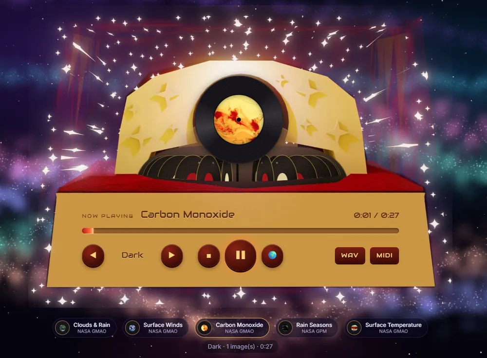
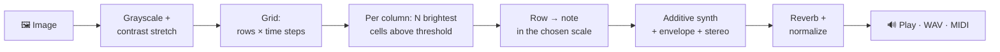

<div align="center">

# 🎵 JukeBox

**Listen to our planet.**
JukeBox turns NASA images of Earth, or any picture you give it, into music right in your browser.

### [▶ Open JukeBox](https://tomson601.github.io/jukebox/)



</div>

---

## 💡 The idea

Satellites send us millions of images of Earth: clouds, winds, temperature, pollution. Usually we only *look* at them.
**JukeBox lets you hear them.** It uses *image sonification*: the picture is read like a music score.

| In the image | In the music |
| :-- | :-- |
| ↔️ **left → right** | ⏱️ **time**: every vertical slice is one beat |
| ↕️ **bottom → top** | 🎼 **pitch**: higher up means a higher note |
| 💡 **brightness** | 🔊 **loudness**: bright pixels play louder, dark ones stay silent |
| 🖼️ **several images** | 🎞️ **a sequence**: they play one after another, like frames of a film |

Every note is snapped to a musical scale, so the result always sounds *in key* rather than random.
Each type of data has its own melody. Storm belts, ocean winds or a carbon-monoxide plume each sound different.

---

## ✨ Features

- 📀 **Record magazine.** 6 ready-made records (albums of 5 frames each) made from NASA climate maps. The jukebox magazine rotates, the chosen record lifts up into the arch and starts spinning, and its image becomes the vinyl label.
- 🌍 **Live Earth photos.** Fetch real photos of the whole sunlit Earth from **NASA EPIC** (the DSCOVR satellite, 1.5 million km away) for any date since 2015. The 🌍 button picks a random day.
- 🖼️ **Your own images.** Drop in JPG, PNG, WebP, GIF, BMP or AVIF files. Click a thumbnail to play that image, use ✓ / + to choose which images go into the piece.
- 🥁 **Backing beat.** Lo-fi, House, Trip-hop or Cosmic drums and bass under the melody. The tempo locks to the step length and the bass plays the scale's root, so it always fits. It is included in the WAV export too.
- 🎛️ **Beat editor.** A 16-step grid for kick, snare, clap, rim, hi-hat, open hat, shaker and bass, with accents, an octave-up bass, tempo, swing, brightness and bass length. Edits play live and are saved as your own *Custom* beat.
- 🔊 **Separate volumes** for the melody and the beat.
- 🌐 **3 languages.** English, Polish and Ukrainian, switchable in the top-right corner. The choice is remembered, and the default follows the browser language.
- 🎚️ **7 presets.** Classic, Ambient, Music box, Dreamy, Dark, Arpeggio, Mystery.
- 🛠️ **15 advanced settings.** Every one has a **?** button that opens a short in-app guide.
- 🌌 **Audio-reactive nebula.** Soft WebGL ribbons behind the jukebox breathe with the bass, mids and highs.
- 📊 **Score view.** A heat-map of exactly what gets played, with a moving playhead.
- 💾 **Export.** Download the piece as **WAV** (44.1 kHz, 16-bit stereo) or **MIDI**, to open in any DAW.
- 🎬 **Video export.** Record an **MP4** (WebM in Firefox) of the jukebox, the spinning record and the music-reactive nebula, together with the music. Formats: 16:9, 1:1 and 9:16. The video is rendered straight from the finished music, faster than real time, so nothing has to play while it is made.
- ♿ **Accessibility.** Reduce motion, a gentle or hidden background (no flashing), high contrast, larger text, mono sound, full keyboard control with shortcuts, and screen-reader-friendly controls. For blind users, every record comes with a spoken guide to what it shows and how to listen to it, the score has a text description, and frame changes are announced while the music plays. All settings are remembered.
- 📱 **Works everywhere.** Responsive on desktop and mobile, with no install, no account and no server. Everything is computed in the browser.

---

## 📀 The records

Every record is an **album of 5 frames** that play one after another, like a short time-lapse.
Click a frame thumbnail to jump to it, or use ✓ / + to leave frames out.

| Record | Data | Frames | Preset |
| :-- | :-- | :-- | :-- |
| ☁️ **Clouds & Rain** | NASA GMAO: precipitation and clouds | 29 Oct 2026, 05:00–09:00 EDT, hourly | Classic |
| 🌬️ **Surface Winds** | NASA GMAO: near-surface wind speed | 29 Oct 2026, 05:00–09:00 EDT, hourly | Ambient |
| 🏭 **Carbon Monoxide** | NASA GMAO: carbon monoxide in the air | 29 Oct 2026, 05:00–09:00 EDT, hourly | Dark |
| 🌧️ **Rain Anomaly** | NASA GPM IMERG: precipitation anomaly | 1–5 Jul 2024, daily | Music box |
| 🌡️ **Surface Temperature** | NASA GMAO: near-surface air temperature | 29 Oct 2026, 05:00–09:00 EDT, hourly | Dreamy |
| 🟣 **Surface Ozone** | NASA GMAO: near-surface ozone | 29 Oct 2026, 05:00–09:00 EDT, hourly | Mystery |

---

## 🎛️ How the sound is made



1. **Prepare.** The image is converted to grayscale. Its contrast is stretched between the *black point* and *white point* percentiles.
2. **Grid.** It is shrunk to a grid of `pitch rows × time steps` with area averaging, so every cell is the mean brightness of its region.
3. **Pick notes.** For each column (one beat), the brightest cells above the *threshold* are chosen, at most *max notes at once*.
4. **Pitch.** Each row is mapped to a note of the selected scale, starting at the *lowest note*.
5. **Synthesize.** Every note is a sum of harmonics (the *timbre*), shaped by an attack/decay envelope. It is panned left to right by pitch and keeps ringing for the *note ring-out* time.
6. **Mix.** A light multi-tap reverb is added and the whole piece is normalized.

> **Length of a piece** ≈ `time steps × step length × number of images`.
> For example, 128 × 0.18 s ≈ 23 s per image.

### Advanced settings

| Group | Setting | What it does |
| :-- | :-- | :-- |
| **Melody** | Scale | Allowed notes: major, minor, pentatonic, dorian, lydian, whole tone, chromatic |
| | Lowest note | Pitch of the bottom row of the image |
| | Pitch rows | How many different pitches the height is split into |
| **Rhythm** | Time steps per image | How many beats each image is sliced into |
| | Step length | Duration of one beat, which sets the tempo |
| | Note ring-out | How long notes sustain, so they overlap into chords |
| **Dynamics** | Max notes at once | 1 = a single melody line, more = fuller chords |
| | Brightness threshold | Cells darker than this stay silent |
| | Loudness contrast (gamma) | How strongly brightness affects volume |
| | Black / white point | Contrast stretch before playing |
| **Sound** | Timbre | classic · sine · soft · hollow · bright |
| | Attack | Plucky (short) or swelling (long) notes |
| | Reverb | Dry room or big hall |
| | Stereo width | Low notes left, high notes right; 0 = mono |

---

## 🚀 Running locally

JukeBox is a static site with no build step and no dependencies.

```bash
git clone https://github.com/Tomson601/Tomson601.github.io.git
cd Tomson601.github.io/docs
python -m http.server 8000
# open http://localhost:8000/jukebox/
```

Opening `docs/jukebox/index.html` directly from disk also works. The demo records are then loaded from `records/embedded.js`, because browsers block `fetch()` for local files.

### 🔑 NASA API key

EPIC photos are downloaded through `api.nasa.gov`. The built-in `DEMO_KEY` allows only a few downloads per hour per IP. After that, JukeBox automatically switches to a backup image proxy. For heavy use, get a free key at [api.nasa.gov](https://api.nasa.gov/) and paste it into the **NASA API key** field.

---

## 🗂️ Project structure

```text
docs/jukebox/
├── index.html        page layout: jukebox stage, settings panels, help dialog
├── style.css         cosmic theme, jukebox overlay positioning, responsive layout
├── app.js            sonification engine, playback, presets, EPIC download, WAV/MIDI export
├── beat.js           backing beat: one bar synthesised with OfflineAudioContext, tiled to the track length
├── i18n.js           translations (EN / PL / UA) and the language switcher logic
├── a11y.js           accessibility settings (motion, background, contrast, text size, mono)
├── record.js         video export: draws every frame on a canvas and encodes it to MP4 with WebCodecs
├── vendor/           mp4-muxer (MIT) – writes the encoded video and audio into an MP4 file
├── carousel.js       rotating record magazine (2D canvas drawn into the jukebox)
├── space.js          starfield + audio-reactive WebGL2 nebula
├── jukebox.webp      jukebox artwork
├── preview.webp      screenshot used in this README
└── records/          6 demo albums: <id>/1–5.webp, <id>-label.webp, embedded.js (for file://)

jukebox_test.py       original Python / Colab prototype that the web engine is ported from
```

### 🧰 Built with

- **Vanilla JavaScript.** No frameworks, no bundler.
- **Web Audio API** for synthesis playback and the real-time frequency analyser.
- **Canvas 2D** for the record magazine and the score, **WebGL2** for the nebula.
- **CSS container queries** to keep the controls glued to the jukebox at any size.

The JavaScript engine is a faithful port of the Python prototype (`numpy` + `mido`) and was checked against it: the audio matches to ~1e-7 and the MIDI files are identical.

---

## 🙏 Data & credits

- 🌍 Earth photos: [NASA EPIC / DSCOVR](https://epic.gsfc.nasa.gov/)
- 🗺️ Climate maps: [NASA GMAO](https://gmao.gsfc.nasa.gov/) and [NASA GPM](https://gpm.nasa.gov/)
- 🔤 Fonts: [Audiowide](https://fonts.google.com/specimen/Audiowide) and [Inter](https://fonts.google.com/specimen/Inter) (Google Fonts)

## 👥 Authors

<table>
  <tr>
    <td align="center"><b>Zofia Modelska</b></td>
    <td align="center"><b>Oleksandra Simeonidi</b></td>
    <td align="center"><b>Aleksandra Mazurek</b></td>
    <td align="center"><b>Tomasz Jarko</b></td>
  </tr>
</table>

## 📄 License

The JukeBox code is released under the [MIT License](LICENSE).
The NASA images belong to their providers (NASA EPIC / DSCOVR, NASA GMAO, NASA GPM) and are used here under NASA's media guidelines.
The bundled [mp4-muxer](docs/jukebox/vendor/mp4-muxer.LICENSE) library is MIT-licensed by its author.

<div align="center">
<br>
<sub>Made with 🎶 and a lot of satellite data.</sub>
</div>
